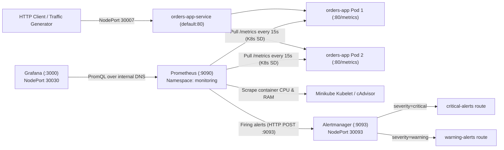
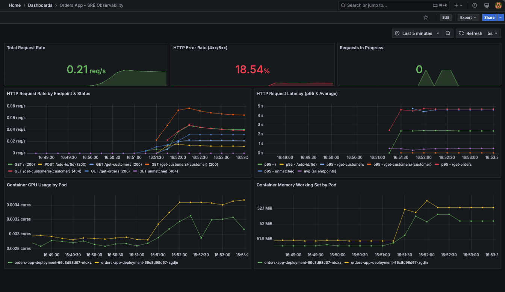
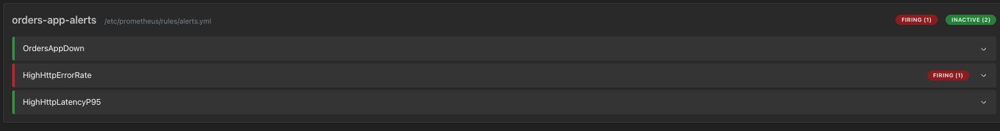
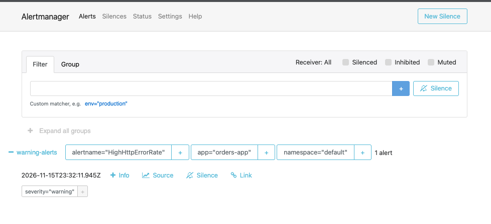

# SRE Observability Stack on Kubernetes (FastAPI + Prometheus + Grafana + Alertmanager)

An end-to-end **Site Reliability Engineering (SRE)** observability project deployed on **Kubernetes (Minikube)**. It instruments a Python **FastAPI** service (`orders-app`) with `prometheus_client`, collects application and container metrics via **Prometheus**, visualizes the **4 Golden Signals** in **Grafana** using *Provisioning as Code*, and automates incident detection and severity-based routing through **Alertmanager**.

---

## Project Architecture

### Kubernetes & Observability Flow

The cluster is separated into two namespaces: `default` for the application workload and `monitoring` for the observability stack.



### Key Architectural Decisions
- **Pull-Based Service Discovery:** Prometheus uses a dedicated `ServiceAccount` and read-only `ClusterRole` (`src/Prometheus/rbac.yaml`) to discover pods automatically via `prometheus.io/scrape`, `prometheus.io/port`, and `prometheus.io/path` annotations, while also scraping container metrics from kubelet cAdvisor.
- **Provisioning & Monitoring as Code:** Grafana data sources, the 7-panel dashboard, Prometheus alerting rules, and Alertmanager routes are stored as Kubernetes `ConfigMap` manifests so the entire monitoring stack recovers automatically after pod restarts.
- **Cardinality-Safe Instrumentation:** FastAPI middleware in `src/main.py` normalizes dynamic route parameters (for example `/get-customers/{customer}`) and excludes `/metrics` from HTTP counters and latency histograms.
- **Severity-Based Routing & Inhibition:** Alertmanager groups alerts by `alertname`, `namespace`, and `app`, routes `critical` vs. `warning` severities independently, and suppresses `warning` noise whenever a `critical` outage alert is already firing for the same application.

---

## Repository Structure

```text
SREProject/
├── .gitignore                         # Ignores virtual environments, caches, and scratch files
├── Dockerfile                         # Container image for orders-app (Python 3.12-slim, port 80)
├── pyproject.toml                     # Python project metadata and dependency specification
├── requirements.txt                   # Exported runtime dependencies used by Docker builds
├── uv.lock                            # Locked dependency versions
├── LICENSE.md                         # MIT License
├── CONTRIBUTING.md                    # Contribution and development guidelines
├── ansible/                           # Declarative IaC deployment & teardown playbooks
│   ├── inventory.ini                  # Local Ansible inventory (127.0.0.1)
│   ├── deploy.yml                     # One-command full stack deployment playbook
│   └── destroy.yml                    # Idempotent stack teardown playbook
├── screenshots/                       # Visual evidence and step-by-step implementation log
│   ├── DocumentingImplProcess.md      # Chronological log with screenshots (image.png - image-18.png)
│   └── image*.png                     # Captured screenshots from deployment and alert testing
└── src/
    ├── main.py                        # Instrumented FastAPI application (/metrics + business endpoints)
    ├── App/
    │   ├── deployment-app.yaml        # orders-app Deployment (2 replicas, probes, limits, annotations)
    │   └── Service.yaml               # NodePort Service (30007)
    ├── Prometheus/
    │   ├── namespace.yaml             # Dedicated 'monitoring' namespace
    │   ├── rbac.yaml                  # ServiceAccount, ClusterRole, and ClusterRoleBinding
    │   ├── configmap.yaml             # prometheus.yml (scrape jobs, alerting target, rule_files)
    │   ├── alerts-configmap.yaml      # Alerting rules (OrdersAppDown, HighHttpErrorRate, HighHttpLatencyP95)
    │   ├── deployment.yaml            # Prometheus server Deployment
    │   └── service.yaml               # NodePort Service (30090)
    ├── Grafana/
    │   ├── datasource-configmap.yaml  # Auto-provisioned Prometheus data source
    │   ├── dashboard-configmap.yaml   # Auto-provisioned 'Orders App - SRE Observability' dashboard
    │   ├── deployment.yaml            # Grafana 11.6.0 Deployment
    │   └── service.yaml               # NodePort Service (30030)
    ├── Alertmanager/
    │   ├── configmap.yaml             # alertmanager.yml (routing tree, inhibit_rules, receivers)
    │   ├── deployment.yaml            # Alertmanager v0.28.1 Deployment
    │   └── service.yaml               # NodePort Service (30093)
    └── scripts/
        └── generate_traffic.py        # Dependency-free Python CLI traffic generator (--help supported)
```

---

## Prerequisites

- **Container Runtime:** **Colima** (recommended on corporate macOS environments) or **Docker**
- **Minikube** (local Kubernetes cluster running on top of Colima/Docker)
- **kubectl** (configured to point to your active Minikube context)
- **Ansible** (`brew install ansible` on macOS — optional, for one-command IaC deployment)
- **Python 3.12+** (optional, for running `src/scripts/generate_traffic.py` or local testing)

---

## Deployment Steps

### 1. Start the Local Cluster (Colima + Minikube)
```zsh
colima start
minikube start
```

### Option A: Automated Deployment with Ansible (IaC)
Deploy the entire stack (`orders-app`, Prometheus, Grafana, and Alertmanager) in order and wait for all pods to become ready with one command:
```zsh
ansible-playbook -i ansible/inventory.ini ansible/deploy.yml
```
*(You can also deploy or re-apply a specific tier using tags, e.g., `--tags grafana` or `--tags prometheus,alertmanager`.)*

### Option B: Manual Deployment Steps (`kubectl`)

#### Deploy `orders-app` (`default` namespace)
```zsh
kubectl apply -f src/App/deployment-app.yaml
kubectl apply -f src/App/Service.yaml
kubectl rollout status deployment/orders-app-deployment
```

#### Deploy Prometheus (`monitoring` namespace)
```zsh
kubectl apply -f src/Prometheus/namespace.yaml
kubectl apply -f src/Prometheus/rbac.yaml
kubectl apply -f src/Prometheus/alerts-configmap.yaml
kubectl apply -f src/Prometheus/configmap.yaml
kubectl apply -f src/Prometheus/deployment.yaml
kubectl apply -f src/Prometheus/service.yaml
kubectl rollout status deployment/prometheus-deployment -n monitoring
```

#### Deploy Grafana (`monitoring` namespace)
```zsh
kubectl apply -f src/Grafana/datasource-configmap.yaml
kubectl apply -f src/Grafana/dashboard-configmap.yaml
kubectl apply -f src/Grafana/deployment.yaml
kubectl apply -f src/Grafana/service.yaml
kubectl rollout status deployment/grafana-deployment -n monitoring
```

#### Deploy Alertmanager (`monitoring` namespace)
```zsh
kubectl apply -f src/Alertmanager/configmap.yaml
kubectl apply -f src/Alertmanager/deployment.yaml
kubectl apply -f src/Alertmanager/service.yaml
kubectl rollout status deployment/alertmanager-deployment -n monitoring
```

### 2. Verify Pods and Access Web UIs
Verify all pods and services are healthy:
```zsh
kubectl get pods,svc -n default
kubectl get pods,svc -n monitoring
```

Expose each service in Minikube (keep the terminal open if Minikube creates a local tunnel):
```zsh
minikube service orders-app-service --url
minikube service prometheus-service -n monitoring --url
minikube service grafana-service -n monitoring --url
minikube service alertmanager-service -n monitoring --url
```

| Service | Namespace | Internal Cluster DNS | NodePort | Credentials |
| :--- | :--- | :--- | :--- | :--- |
| `orders-app-service` | `default` | `orders-app-service.default.svc.cluster.local:80` | `30007` | None |
| `prometheus-service` | `monitoring` | `prometheus-service.monitoring.svc.cluster.local:9090` | `30090` | None |
| `grafana-service` | `monitoring` | `grafana-service.monitoring.svc.cluster.local:3000` | `30030` | `admin` / `admin` |
| `alertmanager-service` | `monitoring` | `alertmanager-service.monitoring.svc.cluster.local:9093` | `30093` | None |

---

## Application Endpoints & Custom Metrics

### FastAPI Endpoints (`src/main.py`)
| Method & Path | Description |
| :--- | :--- |
| `GET /` | Returns `"Hello World"` with a simulated `0–1s` async delay |
| `GET /get-orders` | Returns sample order records with a simulated `0–4s` delay |
| `GET /get-customers` | Returns the full customer directory |
| `GET /get-customers/{customer}` | Returns a customer (`CUST-5001`–`CUST-5003`) or HTTP `404` |
| `POST /add-id/{id}` | Echoes a customer payload tagged with `{id}` |
| `GET /metrics` | Exposes Prometheus metrics in text exposition format |

### Instrumented Metrics
| Metric Name | Type | Labels | Purpose |
| :--- | :--- | :--- | :--- |
| `http_requests_total` | Counter | `method`, `endpoint`, `status` | Total HTTP request count by route and status code |
| `http_request_duration_seconds` | Histogram | `method`, `endpoint` | Request duration distribution (`_bucket`, `_sum`, `_count`) |
| `http_requests_in_progress` | Gauge | `method`, `endpoint` | Current concurrent in-flight HTTP requests |

---

## Grafana Dashboard (4 Golden Signals)

Grafana automatically provisions the **Orders App - SRE Observability** dashboard (`uid: orders-app-observability`) with 7 panels aligned with Google SRE's **4 Golden Signals**:

- **Traffic:** *Total Request Rate* (stat) and *HTTP Request Rate by Endpoint & Status* (time series)
- **Errors:** *HTTP Error Rate (4xx/5xx)* (stat with green/yellow/red thresholds) and error status curves
- **Latency:** *HTTP Request Latency (p95 & Average)* using `histogram_quantile(0.95, ...)`
- **Saturation:** *Requests In Progress* (stat), *Container CPU Usage by Pod*, and *Container Memory Working Set by Pod* (from kubelet cAdvisor)

---

## Alerting Rules & Routing

Prometheus evaluates [src/Prometheus/alerts-configmap.yaml](src/Prometheus/alerts-configmap.yaml) every `15s` and dispatches firing alerts to Alertmanager:

| Alert | Severity | Condition | `for` | Route Receiver |
| :--- | :--- | :--- | :--- | :--- |
| `OrdersAppDown` | `critical` | `up{app="orders-app"} == 0 or absent(up{app="orders-app"} == 1)` | `30s` | `critical-alerts` |
| `HighHttpErrorRate` | `warning` | `4xx`/`5xx` error ratio `> 5%` over `2m` | `30s` | `warning-alerts` |
| `HighHttpLatencyP95` | `warning` | `p95` latency `> 3.5s` over `2m` | `1m` | `warning-alerts` |

In [src/Alertmanager/configmap.yaml](src/Alertmanager/configmap.yaml), an `inhibit_rules` policy suppresses `warning` alerts for the same `app` and `namespace` whenever a `critical` alert is active.

---

## Testing & Incident Simulation

Use [src/scripts/generate_traffic.py](src/scripts/generate_traffic.py) (Python standard library only) to simulate traffic profiles and verify dashboards and alerts:

```zsh
# Display all options and examples
python3 src/scripts/generate_traffic.py --help

# Mixed traffic (~80% 200 OK, ~20% 404) to populate Grafana Golden Signals panels
python3 src/scripts/generate_traffic.py --url <APP_URL> --mode mixed --duration 60

# Trigger HighHttpErrorRate alert
python3 src/scripts/generate_traffic.py --url <APP_URL> --mode errors --duration 75

# Trigger HighHttpLatencyP95 alert (targets /get-orders)
python3 src/scripts/generate_traffic.py --url <APP_URL> --mode latency --duration 120
```

Simulate a full application outage to test `OrdersAppDown`:
```zsh
kubectl scale deployment/orders-app-deployment --replicas=0
# Wait ~45-60s to observe Pending -> Firing in Prometheus and Alertmanager, then restore:
kubectl scale deployment/orders-app-deployment --replicas=2
kubectl rollout status deployment/orders-app-deployment
```

Verify Grafana provisioning resilience after a pod restart:
```zsh
kubectl delete pod -l app=grafana -n monitoring
kubectl rollout status deployment/grafana-deployment -n monitoring
```

---

## Screenshots & Implementation Evidence

The full step-by-step deployment and verification log is available in [screenshots/DocumentingImplProcess.md](screenshots/DocumentingImplProcess.md).

### Grafana Golden Signals Dashboard


### Prometheus Alert Firing (`HighHttpErrorRate`)


### Alertmanager UI Grouping & Routing


---

## Contributing & License

- Contributions are welcome! See [CONTRIBUTING.md](CONTRIBUTING.md) for setup, style, and pull request guidelines.
- This project is licensed under the MIT License — see [LICENSE.md](LICENSE.md) for details.

---

## Cleanup

Remove all deployed Kubernetes resources from Minikube using Ansible:
```zsh
ansible-playbook -i ansible/inventory.ini ansible/destroy.yml
```

Or remove them manually with `kubectl`:
```zsh
kubectl delete -f src/App/
kubectl delete -f src/Prometheus/rbac.yaml
kubectl delete namespace monitoring
```
