# Implementation Process & Visual Evidence

This document records the step-by-step deployment, instrumentation, observability verification, and alert testing carried out on Minikube.

---

### 1. Application Deployment & External Access
Created the initial `Deployment` and `NodePort` `Service` (`orders-app-service`), then exposed the service locally using `minikube service orders-app-service --url`.


Accessing the service from outside the cluster:


---

### 2. Prometheus Instrumentation & Updated Container Image
Instrumented `src/main.py` with `prometheus_client` metrics (`http_requests_total`, `http_request_duration_seconds`, `http_requests_in_progress`) and built the updated Docker image (`marvins123/orders-app:v2`).

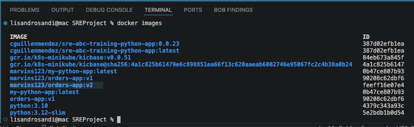

Testing the updated container image locally:
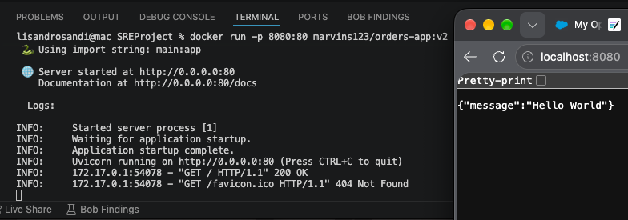

Redeployed `orders-app` (`Deployment` + `Service`) with resource limits, health probes, and Prometheus scrape annotations:


---

### 3. Prometheus Integration
Deployed Prometheus inside the `monitoring` namespace with RBAC service discovery and verified scraped application metrics:


Testing `http_requests_total` queries in the Prometheus Web UI:
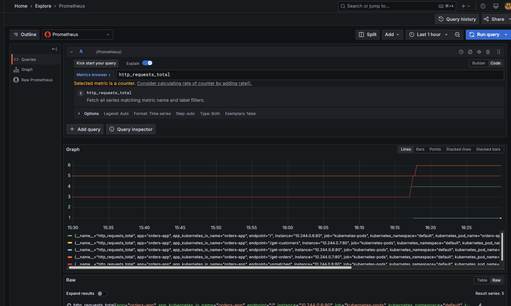

---

### 4. Grafana Deployment & Golden Signals Dashboard
Deployed Grafana in `monitoring` (initial UI before connecting the Prometheus data source):


Verified auto-provisioned Prometheus data source (`Successfully queried the Prometheus API`):
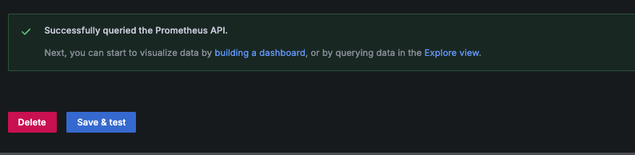

Verified the auto-provisioned **Orders App - SRE Observability** (4 Golden Signals) dashboard while running `src/scripts/generate_traffic.py`:
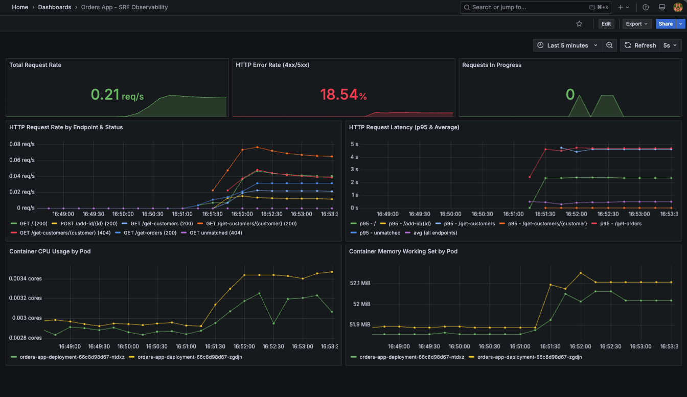

---

### 5. Alertmanager Deployment & Alerting Verification

#### Monitoring Stack Overview
Deployed Alertmanager (`prom/alertmanager:v0.28.1`) in the `monitoring` namespace alongside Prometheus and Grafana:

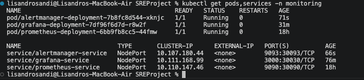

#### High HTTP Error Rate Alert (`HighHttpErrorRate`)
Triggered with `python3 src/scripts/generate_traffic.py --url <APP_URL> --mode errors --duration 75`:

- Transitioning to `Pending`:
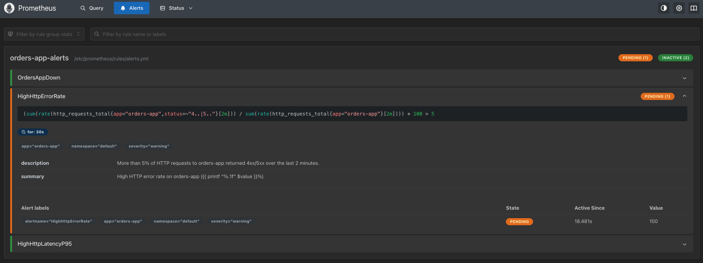

- Transitioning to `Firing` in Prometheus:
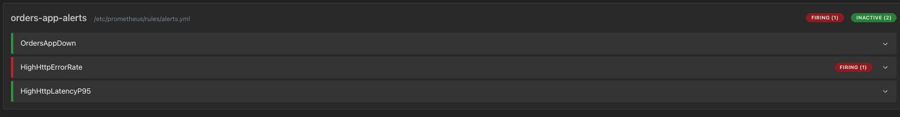

- Received, grouped, and routed in Alertmanager UI:
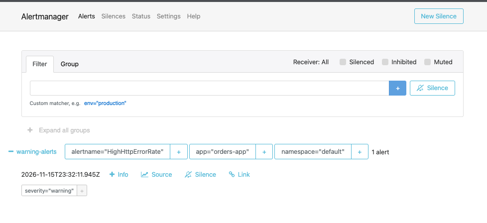

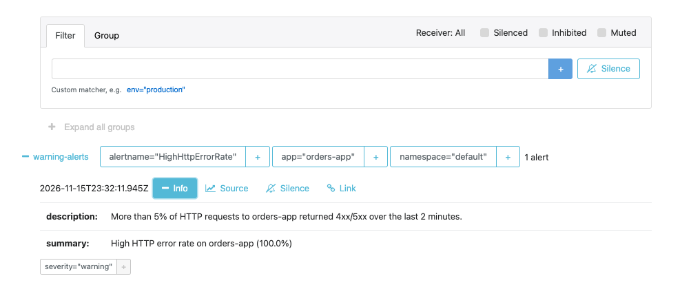

#### Application Outage Alert (`OrdersAppDown`)
Triggered by scaling the application to zero replicas and then restoring healthy replicas:
```zsh
kubectl scale deployment/orders-app-deployment --replicas=0
# After observing the critical alert fire, restore healthy replicas:
kubectl scale deployment/orders-app-deployment --replicas=2
kubectl rollout status deployment/orders-app-deployment
```

From Prometheus:


From Alertmanager:


#### High Latency Alert (`HighHttpLatencyP95`)
Triggered using `python3 src/scripts/generate_traffic.py --url <APP_URL> --mode latency --duration 120`:

From Prometheus:
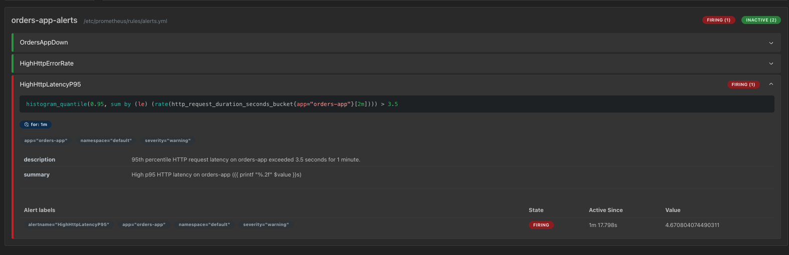

From Alertmanager:

