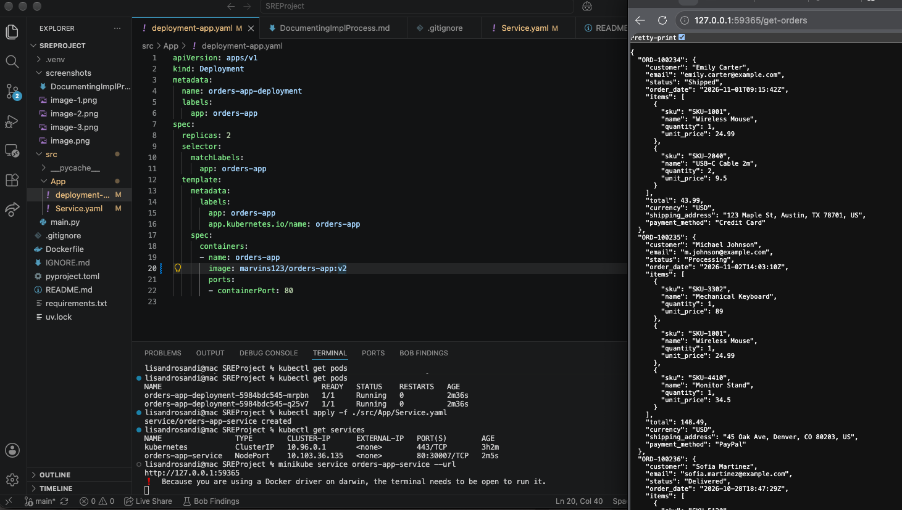
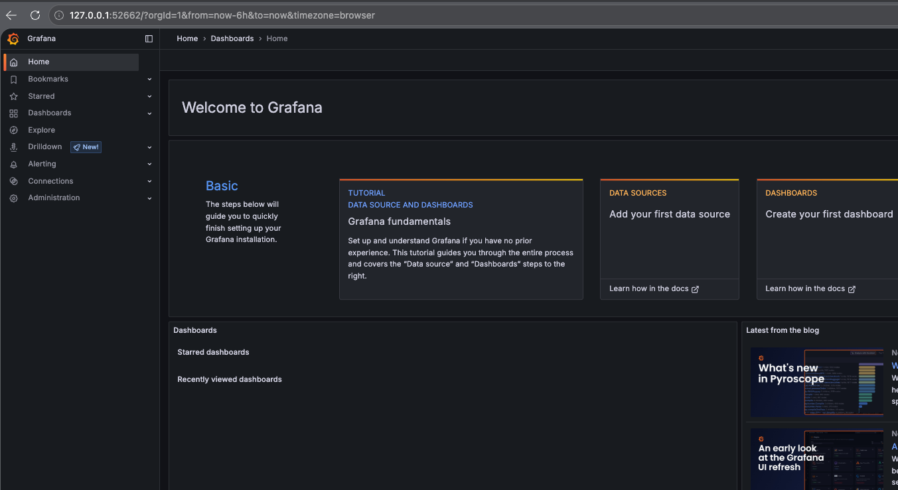

### Deployment of the app
As a first step, i created a deployment and a service.
I use minikube service orders-app-service --url to access my project from outside.

Accesing from outside:

### Added new code (instrumentation) and created a new image with that

### Testing the new image

### Deployment + service created: app deployed and accesible from outside the cluster

### Prometheus showing some metrics

### Got Grafana working, still not connected to prometheus

### Successfully queried the Prometheus API

### Testing http_request_total

