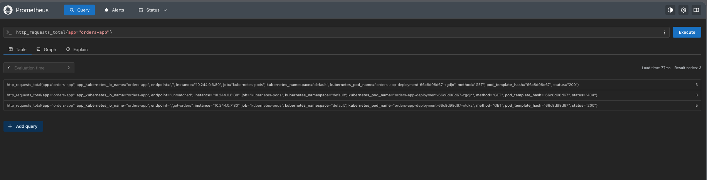
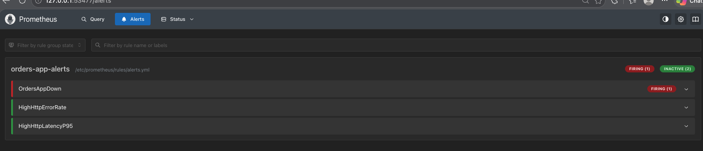
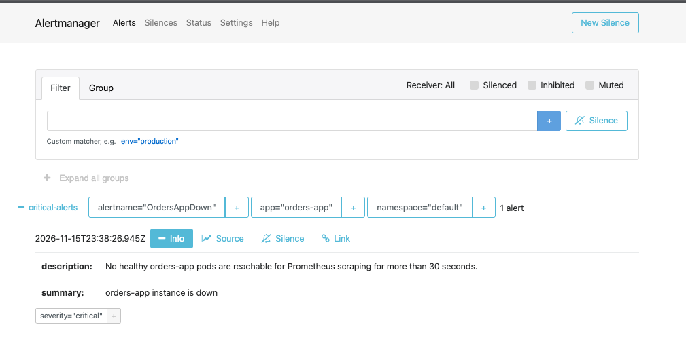
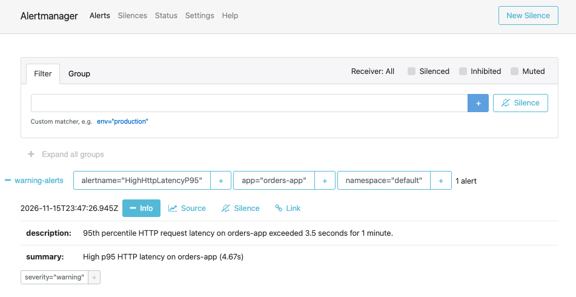

### Deployment of the app
As a first step, i created a deployment and a service.
I use minikube service orders-app-service --url to access my project from outside.

Accesing from outside:

### Added new code (instrumentation) and created a new image with that

### Testing the new image

### Deployment + service created: app deployed and accesible from outside the cluster

### Prometheus showing some metrics

### Got Grafana working, still not connected to prometheus

### Successfully queried the Prometheus API

### Testing http_request_total

### Golden signals dashboard
Sent traffic with the script

### Monitoring stack so far
The requirement number 5 says "Alertmanager DEPLOYMENT", so i investigated and found there is a sofware developed by the same people who developed prometheus that allows me to deploy an alertmanager software.

### High error rate fired

### Orders-app down fired
Command to trigger: kubectl scale deployment/orders-app-deployment --replicas=0

To go back healthy: 
kubectl scale deployment/orders-app-deployment --replicas=2                                                                                       

kubectl rollout status deployment/orders-app-deployment 
From prometheus:

From Alertmanager: 
Tested it with the latency mode of the script

### High latency fired

